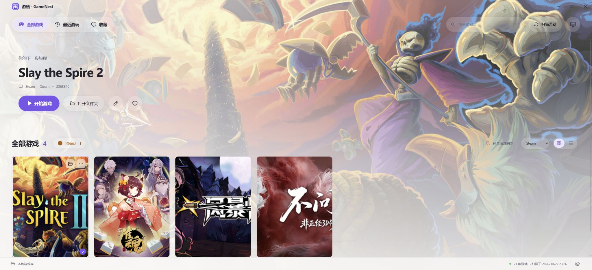

# 游栖 · GameNest

**让收藏的游戏有个家。**

面向 Windows 的本地游戏收藏与启动应用：将硬盘里的游戏整理成封面墙，集中搜索、收藏、启动，并按需补全名称、封面和背景。基于 **Go + Wails 2 + Vue 3 + TypeScript**，使用系统 WebView2，日常使用无需 Python 或本地 HTTP 服务。

## 主界面



截图来自实际应用的本机预览模式，已选择 **Steam** 来源。游戏名称、商标、封面与背景归各自权利人所有，仅用于展示管理界面；仓库不包含游戏本体或用户游戏清单。

## 功能

- **扫描与管理**：自定义盘符、文件夹及排除位置，区分 Steam、Epic 和本地游戏。
- **浏览与启动**：封面墙、列表、搜索、收藏、最近游玩、启动游戏及打开所在文件夹。
- **资料整理**：修改名称、选择启动程序、上传封面，按名称、Steam AppID / 商店链接、DLsite RJ 编号检索。
- **多来源补全**：Steam、VNDB、DLsite；可选 SteamGridDB 图片，身份冲突的候选留待人工确认。
- **界面与存储**：亮色、暗色、跟随系统，资料及图片保存在本机，已缓存图片可离线使用。

## 环境要求

- Windows 10 / 11；当前仅验证 Windows，部分系统集成依赖 Windows API。
- [Microsoft Edge WebView2 Runtime](https://developer.microsoft.com/microsoft-edge/webview2/)。
- 构建需要 Go 1.23+、Node.js 18+（含 npm）、Wails CLI **v2.12.0** 及 Windows Go 构建工具链。
- 首次安装依赖及查询在线资料时需要联网。

## 从源码运行

在 PowerShell 中执行：

```powershell
git clone https://github.com/sagirisense/gamenest.git
cd gamenest/desktop
go install github.com/wailsapp/wails/v2/cmd/wails@v2.12.0
# 确保 $(go env GOPATH)/bin 已加入 PATH
wails doctor
npm --prefix frontend ci
go mod download
if (-not (Test-Path data/games.json)) {
    New-Item -ItemType Directory -Path data -Force | Out-Null
    Copy-Item data.example/games.json data/games.json
}
wails dev
```

前端单独执行 `npm run dev` 不会启动 Go 后端；完整应用请使用 `wails dev`。首次初始化使用空游戏库，随后在设置中选择自己的游戏目录。

## 构建桌面程序

```powershell
cd desktop
./build-release.ps1
```

脚本安装锁定依赖、运行 Go 测试并构建 Wails 应用，输出为根目录下的 **`游栖/游栖.exe`**。首次构建生成空游戏库，重复构建保留输出目录内已有的 `data/`；不会将开发者的个人游戏资料打包。

分发时保留相邻的 `LICENSE`、`THIRD_PARTY_NOTICES.md` 和 `licenses/`。也可直接运行 `wails build`，产物为 `desktop/build/bin/GameNest.exe`。本仓库目前提供源码，尚未发布安装包。

## 使用方式

1. 打开右下角 **设置**，添加游戏盘符或文件夹，并按需设置排除位置。默认扫描 `D:\`，请先调整为自己的游戏目录。
2. 点击 **扫描游戏**。扫描完成后自动补全缺少的资料；网络失败不影响已保存的清单。
3. 通过来源筛选选择 **Steam / Epic / 本地游戏**，或按 `Ctrl+F` 搜索。单击查看详情，双击启动，爱心按钮加入收藏。
4. 右键卡片或进入 **编辑资料**，修改名称、启动程序、封面和背景。有 **待确认** 标记时，核对作品编号、平台及图片后再应用。
5. SteamGridDB 为可选功能：在 **设置 → 图片来源 · SteamGridDB** 中填写自己的 API Key，再查询并手动选择图片。

更多操作、备份及迁移说明见 [使用指南](docs/USAGE.md)。

## 数据与联网

`data/games.json` 保存游戏清单；`metadata.json` 保存编辑资料；`preferences.json` 保存主题、收藏、最近记录及扫描范围；`covers/`、`icons/`、`backgrounds/` 保存图片。退出应用后备份整个 `data/` 即可。游戏本体保留在原位置，应用不会复制或删除游戏；换机后绝对路径可能需要重新扫描。

在线查询向对应服务发送名称、作品编号或 AppID；DLsite 备用检索还会使用外部搜索引擎。应用读取游戏路径及少量本地说明文本以提取编号，不上传完整游戏清单或本地文件内容。SteamGridDB 密钥经 Windows 当前账号加密保存在 `data/integrations.json`，换账号或电脑后需重新填写。请勿提交个人 `data/`。

## 开发与贡献

```powershell
cd desktop
npm --prefix frontend ci
npm --prefix frontend run build
go test ./...
wails build
```

Go 测试依赖嵌入的前端产物，干净克隆后请先构建前端。测试使用临时目录及本地模拟服务，无需真实游戏或 API Key。

欢迎通过 [Issues](https://github.com/sagirisense/gamenest/issues) 反馈问题或提交 Pull Request。请提供复现步骤、系统版本及已脱敏错误信息。提交格式为 `<type>(<scope>): <subject>`；类型使用 `feat`、`fix`、`docs`、`style`、`refactor`、`perf`、`test`、`chore`，中文主题不超过 50 字符。

源码位于 `desktop/`，前端位于 `desktop/frontend/`，空游戏库模板位于 `desktop/data.example/`，文档及截图位于 `docs/`，第三方许可原文位于 `licenses/`。

## 协议与致谢

项目自有代码采用 [MIT License](LICENSE)，Copyright © 2026 Sagiri_sense。第三方代码、字体及素材保留各自许可。

感谢 [Wails](https://github.com/wailsapp/wails)、[Vue](https://github.com/vuejs/core)、[Vite](https://github.com/vitejs/vite)、[TypeScript](https://github.com/microsoft/TypeScript)、[Phosphor Icons](https://github.com/phosphor-icons/vue)、[Go](https://go.dev/) 及其贡献者。

资料和图片查询使用 Steam、VNDB、DLsite、SteamGridDB 等服务，应用与这些平台无隶属关系。完整引用、素材说明及依赖许可见 [第三方声明与致谢](THIRD_PARTY_NOTICES.md)。
